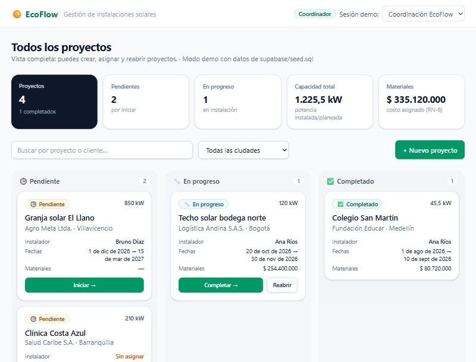
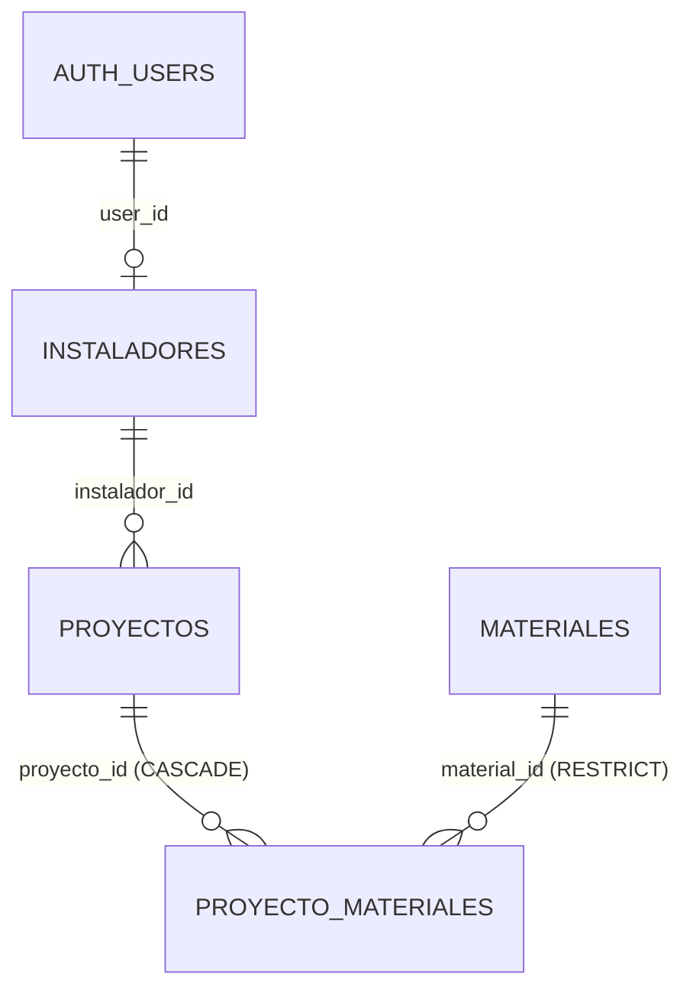
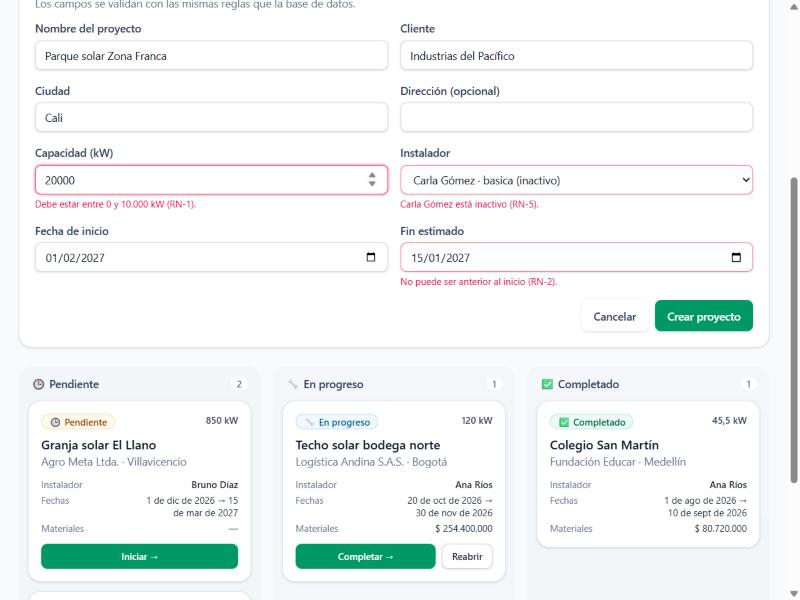
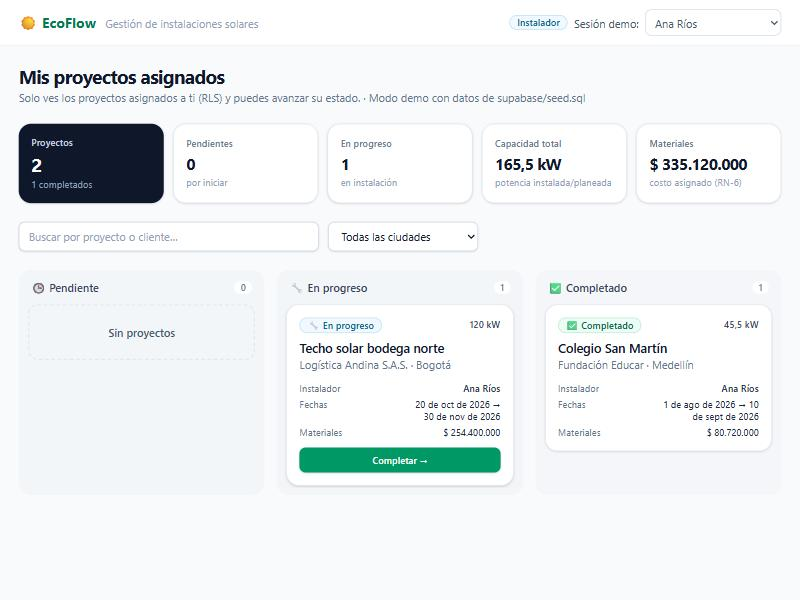
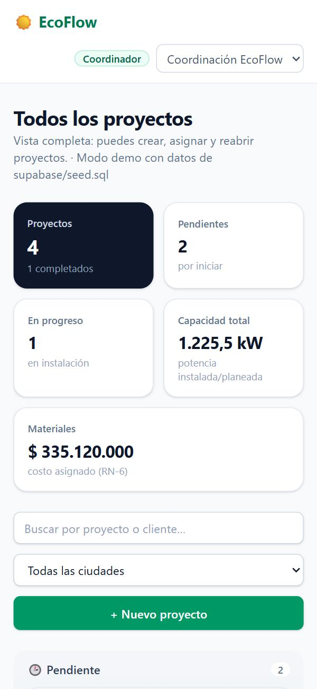

# ☀️ EcoFlow · Gestión de Proyectos Solares

**Proyecto Final Integrador: El Arquitecto IA.** Aplicación interna para gestionar proyectos de instalación de paneles solares, construida con **Arquitectura Basada en Especificaciones** sobre **React 19 + TypeScript strict + Vite + Tailwind CSS v4 + Supabase**.



## 📦 Entregables

| Entregable | Dónde |
|---|---|
| **Código fuente** (React) | [`src/`](src) |
| **Documento de arquitectura** (diagrama de BD, prompts clave, estructura, uso de IA) | [`docs/ARQUITECTURA.md`](docs/ARQUITECTURA.md) |
| **Especificación técnica / prompt maestro** | [`docs/ESPECIFICACION_TECNICA.md`](docs/ESPECIFICACION_TECNICA.md) |
| Esquema SQL + RLS + datos de ejemplo | [`supabase/migrations/`](supabase/migrations) · [`supabase/seed.sql`](supabase/seed.sql) |
| Guion del video demo | [`docs/GUION_VIDEO.md`](docs/GUION_VIDEO.md) |

## ✨ Funcionalidad

- **Dashboard (UI-1):** KPIs (proyectos, pendientes, en progreso, kW totales, costo de materiales), columnas **Pendiente / En progreso / Completado**, búsqueda y filtro por ciudad.
- **Formulario de nuevo proyecto (UI-2):** valida en el cliente las mismas reglas que la BD (capacidad, fechas, instalador activo) con mensajes por campo, antes de enviar a Supabase.
- **Roles con RLS:** el **coordinador** ve y crea todo; el **instalador** solo ve sus proyectos asignados y solo puede **avanzar su estado** un paso.
- **Cambio de estado optimista** con rollback y el motivo de la regla que se violó.
- Estados de **carga** (skeleton), **error** (reintentar) y **vacío**; responsive y accesible.

## 🗄️ Modelo de datos



Políticas RLS, triggers y justificación: [ARQUITECTURA.md §3](docs/ARQUITECTURA.md#3-seguridad-políticas-rls).

## ✅ Verificación

| | Resultado |
|---|---|
| Esquema, RLS y reglas de negocio en PostgreSQL 16 | **15/15** · [`docs/rls-test-log.txt`](docs/rls-test-log.txt) |
| Tests de hooks y validación (Vitest) | **20/20** · [`docs/test-log.txt`](docs/test-log.txt) |
| `tsc` strict + build + oxlint | ✅ |

```bash
npm install
npm test          # 20 tests
npm run build
npm run dev       # sin .env arranca en modo demo (datos de supabase/seed.sql)
```

En **modo demo**, el selector de la esquina superior derecha cambia entre **Coordinación**, **Ana Ríos** y **Bruno Díaz**, para ver cómo cambian los datos visibles según el rol. Para conectar con Supabase real, ver [ARQUITECTURA.md §7](docs/ARQUITECTURA.md#7-conectar-con-supabase-real).

## 🤖 Uso de IA (resumen)

- La IA trabajó siempre a partir del **prompt maestro**, con IDs de reglas trazables hasta el código y las pruebas.
- **Tipos TypeScript:** el borrador de la IA se comparó con los tipos **generados desde el esquema real**, y aparecieron 5 errores (`Date` vs `string`, columnas que en realidad aceptan `NULL`…). Ver el [diff](docs/tipos/diff-borrador-vs-generado.diff).
- **Problema complejo:** una vista normal se salta el RLS porque se ejecuta como su dueño. Se resolvió con `security_invoker = true` y se cubrió con una prueba de regresión ([§5.3](docs/ARQUITECTURA.md#53-problema-técnico-complejo-una-vista-que-se-saltaba-el-rls)).

## 📸 Capturas

| Validación del formulario | Instaladora: solo sus proyectos (RLS) | Móvil |
|---|---|---|
|  |  |  |
