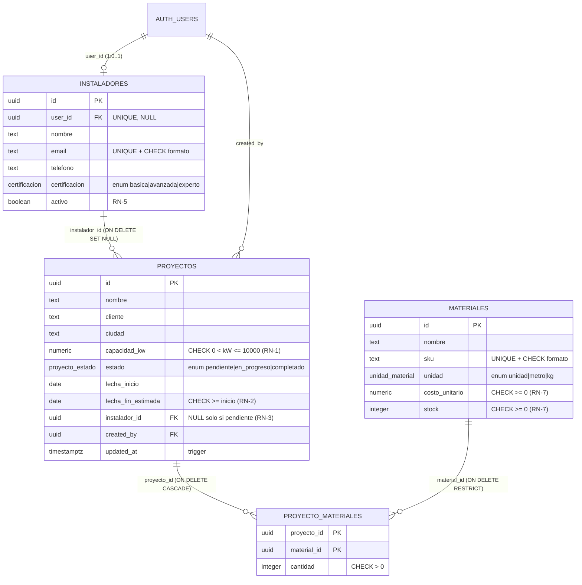

# Documento de Arquitectura: EcoFlow

**Proyecto Final Integrador: El Arquitecto IA**
Aplicación interna para gestionar proyectos de instalación de paneles solares.
**Stack:** React 19 · TypeScript (strict) · Vite 8 · Tailwind CSS v4 · Supabase (PostgreSQL + Auth + RLS)

---

## 1. Proceso: Arquitectura Basada en Especificaciones

```
 ① Especificación técnica      ② Esquema SQL + RLS        ③ Verificación en BD       ④ Tipos TS          ⑤ Hooks + UI         ⑥ Verificación final
 (prompt maestro, RN/SEG/UI) → (guiado por RN-x/SEG-x) → (15 pruebas en Postgres) → (generados del   → (consumen tipos)  → (20 tests + navegador)
                                                                                    esquema real)
```

La [Especificación Técnica](ESPECIFICACION_TECNICA.md) es el **contrato**. Cada regla tiene un identificador (`RN-1`…`RN-7`, `SEG-1`…`SEG-7`, `UI-1`…`UI-6`) que aparece en el SQL, en el código React, en los mensajes de error y en las pruebas. Así se puede rastrear cada línea hasta un requisito. La especificación termina con una tabla de trazabilidad.

---

## 2. Modelo de datos



### Decisiones de diseño

| Decisión | Justificación |
|---|---|
| `proyecto_materiales` como tabla puente con PK compuesta | Un proyecto usa muchos materiales y un material va en muchos proyectos. La PK `(proyecto_id, material_id)` impide duplicados sin necesitar un `id` extra. |
| `ON DELETE CASCADE` en `proyecto_materiales.proyecto_id` | Si se borra un proyecto, sus líneas de materiales dejan de tener sentido. |
| `ON DELETE RESTRICT` en `material_id` | No se puede borrar un material del catálogo que ya fue usado: protege el histórico de costos. |
| `ON DELETE SET NULL` en `instalador_id` | Si un instalador sale de la empresa, el proyecto se conserva. El `CHECK` de RN-3 obliga a reasignarlo antes de avanzar. |
| `ENUM` para estado, certificación y unidad | Valores cerrados que la BD valida, no el frontend. |
| `numeric(8,2)` para kW y `numeric(12,2)` para dinero | Evita los errores de redondeo de `float`. |
| `instaladores.user_id` separado de `id` | Un instalador puede existir en la ficha antes de tener cuenta. La vinculación con Auth es opcional. |
| Vista `v_proyectos_resumen` | Calcula el costo de materiales en la BD (RN-6) con un `LEFT JOIN` + `SUM`. Es una sola consulta para el dashboard, sin N+1. |
| Índices en todas las FK y en `estado` | Las políticas RLS filtran por `instalador_id` en cada consulta. |

---

## 3. Seguridad: políticas RLS

El rol viene de `auth.jwt() -> 'app_metadata' ->> 'role'`, que **solo puede escribir el servidor** (SEG-1). `user_metadata` no se usa porque cada usuario puede editar el suyo con `supabase.auth.updateUser()`.

| Tabla | SELECT | INSERT | UPDATE | DELETE |
|---|---|---|---|---|
| `proyectos` | Coordinador: todo · Instalador: `instalador_id = mi_instalador_id()` | Coordinador | Coordinador; instalador **solo sus proyectos y solo `estado`** (trigger) | Coordinador |
| `instaladores` | Coordinador: todo · Instalador: su propia ficha | Coordinador | Coordinador | Coordinador |
| `materiales` | Cualquier autenticado (catálogo) | Coordinador | Coordinador | Coordinador |
| `proyecto_materiales` | Si el proyecto es visible (hereda RLS de `proyectos`) | Coordinador | Coordinador | Coordinador |
| todas | `anon`: **sin acceso** (`REVOKE ALL`): es una app interna | | | |

**Por qué un trigger además de RLS:** RLS decide **qué filas** puede tocar un usuario, pero no **qué columnas** ni **qué transiciones**. El trigger `validar_proyecto()` completa lo que falta:
- Un instalador que intenta cambiar `capacidad_kw`, las fechas o la asignación recibe `SEG-2: un instalador solo puede modificar el estado`.
- Las transiciones de estado solo avanzan un paso (RN-4). El coordinador puede corregir cualquier transición.
- Solo se asignan instaladores activos (RN-5).

**Funciones auxiliares:** `mi_instalador_id()` es `SECURITY DEFINER` con `set search_path = ''`. Así la política de `proyectos` puede consultar `instaladores` sin entrar en recursión de RLS y sin abrir la puerta a un secuestro del `search_path`.

### Verificación (PostgreSQL 16)

[`supabase/tests/rls_test.sql`](../supabase/tests/rls_test.sql) simula `auth.uid()`/`auth.jwt()` y actúa como cada rol. Resultado completo en [`rls-test-log.txt`](rls-test-log.txt):

```
OK 1  SEG-2 Ana (instaladora) ve solo sus 2 proyectos asignados de 4
OK 4  SEG-2 una instaladora solo puede cambiar el estado (no capacidad, fechas ni asignación)
OK 6  RN-4 la instaladora no puede retroceder el estado (en_progreso -> pendiente)
OK 9  RN-3 no se puede iniciar un proyecto sin instalador asignado
OK 13 RN-6 costo de materiales del proyecto = 254400000.00 (220 paneles + 12 inversores)
OK 14 SEG-6 vista sin security_invoker FILTRA 4 proyectos; v_proyectos_resumen (security_invoker) solo 2
...
=== 15/15 PRUEBAS DE ESQUEMA Y RLS OK ===
```

---

## 4. Estructura del frontend

```text
src/
├── types/
│   ├── database.types.ts     # GENERADO desde el esquema real (no editar a mano)
│   └── domain.ts             # Modelos de dominio derivados: Tables<'proyectos'>, Enums<'proyecto_estado'>…
├── lib/
│   ├── supabase.ts           # Cliente único tipado (anon key, PKCE), SEG-7
│   ├── errors.ts             # Traduce errores de Postgres (incl. RN-x de triggers) a mensajes claros
│   └── cn.ts
├── services/                 # ÚNICA capa que conoce supabase-js
│   ├── repository.ts         # Interfaz EcoFlowRepository
│   ├── supabaseRepository.ts # Implementación real (vista + tablas)
│   └── demoRepository.ts     # Implementación en memoria que replica RLS y RN-x (demo/tests)
├── context/                  # RepositoryProvider: inyección de dependencias
├── hooks/
│   ├── useProyectos.ts       # useReducer: carga, KPIs, filtros, creación, cambio de estado optimista + rollback
│   ├── useInstaladores.ts / useMateriales.ts / useAsyncList.ts
│   ├── useSesion.ts          # Supabase Auth + onAuthStateChange (con cleanup)
│   └── useRepository.ts
├── utils/
│   ├── validation.ts         # validateProyecto(): réplica en cliente de RN-1, RN-2, RN-5
│   └── format.ts             # Intl (COP, kW, fechas `date` en UTC)
└── components/
    ├── ui/                   # Kit base estilo shadcn/ui: Button, Card, Badge, Field/Input/Select, Skeleton…
    ├── Dashboard.tsx         # UI-1: KPIs + filtros + columnas por estado
    ├── ProyectoCard.tsx      # Presentacional (memo)
    ├── ProyectoForm.tsx      # UI-2: formulario validado
    ├── KpiCards.tsx · AppShell.tsx · LoginForm.tsx
```

**Regla de dependencias:** `components → hooks → services → supabase-js`. Ningún componente importa `supabase-js` (UI-4). Los hooks dependen de la **interfaz** `EcoFlowRepository`, así que la misma UI funciona con Supabase real o con el repositorio de demostración, y los tests no necesitan red.

**Hooks y estados (UI-3):**
- `useProyectos` modela el estado con un **reducer puro** (`CARGA_OK`, `ESTADO_OPTIMISTA`, `ESTADO_ROLLBACK`…). Cambiar el estado es **optimista**: la tarjeta se mueve al instante y, si la BD lo rechaza (p. ej. RN-4), vuelve a su lugar con el mensaje de la regla.
- La clave de carga incluye al usuario. Al cambiar de sesión **nunca** se muestran datos del usuario anterior: hay un test específico para eso.
- Cada efecto asíncrono usa un flag `active` en el cleanup para no actualizar componentes desmontados.
- Los KPIs, filtros y agrupación por estado se calculan con `useMemo`, y `ProyectoCard` y `KpiCards` usan `memo`.

---

## 5. Uso estratégico de la IA

### 5.1 Prompts clave

| # | Prompt (resumen) | Control de diseño aplicado |
|---|---|---|
| 0 | **Prompt maestro** ([ESPECIFICACION_TECNICA.md](ESPECIFICACION_TECNICA.md)): rol, contexto, modelo de datos, RN/SEG/UI y formato. Se pega al inicio de cada sesión. | Prohíbe inventar tablas o columnas y exige preguntar ante ambigüedades. |
| 1 | *"Con la especificación adjunta, genera la migración SQL de EcoFlow: tipos enum, tablas con FK y CHECK que implementen RN-1, RN-2, RN-3 y RN-7, índices para las FK y las columnas usadas por RLS. Comenta cada CHECK con su ID de regla."* | Revisé cada `ON DELETE` contra el negocio: `RESTRICT` en materiales para conservar el histórico de costos, `SET NULL` en instalador. |
| 2 | *"Escribe las políticas RLS para SEG-1…SEG-6. El rol sale de app_metadata. Un instalador solo puede actualizar la columna estado y avanzar un paso (RN-4). Explica qué parte NO puede resolver RLS y resuélvela con un trigger."* | Obliga a separar **filas** (RLS) de **columnas y transiciones** (trigger). |
| 3 | *"Genera los tipos TypeScript (Row/Insert/Update) de este esquema para supabase-js v2, con helpers Tables<>, Enums<> y Views<>."* | El borrador de la IA se comparó con los tipos **generados desde la BD real** (sección 5.2). |
| 4 | *"Implementa useProyectos(sessionKey) con useReducer: carga, KPIs con useMemo, crear proyecto y cambio de estado optimista con rollback. Debe depender de la interfaz EcoFlowRepository, no de supabase-js. Sin `any`."* | Pedí explícitamente la inyección de dependencias para poder probar los hooks sin red. |
| 5 | *"El dashboard del instalador muestra proyectos de otros instaladores cuando lee v_proyectos_resumen, aunque proyectos tiene RLS. ¿Por qué?"* | Ver sección 5.3. |

### 5.2 Tipos TypeScript: la IA propone, la base de datos decide

La IA generó un [borrador de tipos](tipos/borrador-ia.ts) solo a partir de la especificación. En lugar de pegarlo tal cual, generé los tipos desde el **esquema real** de PostgreSQL con [`scripts/introspect.sql`](../scripts/introspect.sql) + [`scripts/gen-types.mjs`](../scripts/gen-types.mjs), el equivalente local de `npx supabase gen types typescript`. El [diff completo](tipos/diff-borrador-vs-generado.diff) mostró errores que habrían llegado a producción:

| Campo | Borrador IA | Real (generado) | Consecuencia del error |
|---|---|---|---|
| `proyectos.instalador_id` | `string` | `string \| null` | La UI habría asumido que siempre hay instalador y fallaría con los proyectos sin asignar (RN-3). |
| `fecha_inicio`, `fecha_fin_estimada` | `Date` | `string` | supabase-js devuelve `"2026-12-01"`, no `Date`. Llamar a `.getTime()` habría lanzado un error. |
| `direccion`, `telefono`, `user_id`, `created_by` | `string` | `string \| null` | Columnas opcionales tratadas como obligatorias. |
| `Insert` / `Update` | no existían | generados | Sin ellos, `.insert()` no valida qué campos son opcionales (`id`, `estado`, `created_at`…). |
| `v_proyectos_resumen` | no existía | `Views` | La consulta principal del dashboard no estaba tipada. |

Como solución, `database.types.ts` se marca como **archivo generado** (se regenera con `npm run gen:types`) y `domain.ts` deriva todos los modelos de él (`Tables<'instaladores'>`, `Enums<'proyecto_estado'>`). Si el esquema cambia, el compilador señala cada uso afectado. Para formatear fechas, `format.ts` interpreta las columnas `date` como UTC y evita el desfase de un día por zona horaria.

### 5.3 Problema técnico complejo: una vista que se saltaba el RLS

**El riesgo:** la forma habitual de crear la vista del dashboard es `create view public.v_proyectos_resumen as select …`. Escrita así, las consultas directas a `proyectos` respetan RLS, pero la vista devuelve **los 4 proyectos** a una instaladora que solo tiene 2 asignados. La prueba 14 lo reproduce.

**Diagnóstico (prompt 5):** en PostgreSQL una vista se ejecuta por defecto con los privilegios de su **dueño** (`postgres` en Supabase), que tiene `BYPASSRLS`. Las políticas de las tablas subyacentes nunca se evaluaban para el usuario real. Es un error frecuente en Supabase, y el *Security Advisor* lo marca como `security_definer_view`.

**Solución:** `create view … with (security_invoker = true)` (PostgreSQL 15+). La vista se ejecuta con los permisos de **quien consulta**, así que el RLS de `proyectos`, `instaladores` y `proyecto_materiales` se aplica a cada fila del `JOIN`. Además: `revoke all … from anon` y la regla SEG-6 en la especificación para que no se repita.

**Prueba de regresión** (prueba 14 de `rls_test.sql`): se crea a propósito una vista sin `security_invoker` y se consultan ambas como la instaladora Ana:

```
OK 14 SEG-6 vista sin security_invoker FILTRA 4 proyectos; v_proyectos_resumen (security_invoker) solo 2
```

### 5.4 Correcciones encontradas al probar en el navegador

La última iteración fue **usar la app**, no solo compilarla:

1. **KPI invisible:** la tarjeta destacada usaba `<Card className="bg-slate-900 text-white">`, pero `bg-white` de `Card` ganaba en la cascada de Tailwind: el "4" quedaba blanco sobre blanco. Se separó en un elemento propio.
2. **Error lejos del contexto:** al pulsar "Iniciar" en un proyecto sin instalador, la BD lo rechazaba (RN-3) y el aviso aparecía arriba de la página, lejos de la tarjeta. Ahora el botón se deshabilita y muestra "Requiere instalador". La BD sigue validando por si alguien llama a la API directamente.

---

## 6. Calidad y verificación

| Verificación | Resultado |
|---|---|
| Esquema + RLS + reglas de negocio en PostgreSQL 16 | **15/15** ([log](rls-test-log.txt)) |
| Tests de frontend (Vitest + Testing Library) | **20/20** ([log](test-log.txt)): validación RN-1/2/5, RLS por rol, KPIs, filtros, creación, optimista + rollback (RN-3, RN-4), reintento, cambio de usuario |
| `tsc -b` (strict, sin `any`) + `vite build` | ✅ |
| `oxlint` | ✅ sin avisos |
| Prueba manual en el navegador (escritorio y 375px) | ✅ [capturas](capturas) |

## 7. Conectar con Supabase real

```bash
npx supabase link --project-ref <REF>
npx supabase db push                     # aplica supabase/migrations
psql "$DB_URL" -f supabase/seed.sql      # o: npx supabase db reset (local)
npm run gen:types                        # o: npx supabase gen types typescript --linked > src/types/database.types.ts
cp .env.example .env                     # VITE_SUPABASE_URL + VITE_SUPABASE_ANON_KEY
```

Asignar roles (en el SQL Editor; solo el servidor puede escribir `app_metadata`):

```sql
update auth.users set raw_app_meta_data = raw_app_meta_data || '{"role":"coordinador"}' where email = 'coordinacion@ecoflow.co';
update auth.users set raw_app_meta_data = raw_app_meta_data || '{"role":"instalador"}'  where email in ('ana.rios@ecoflow.co', 'bruno.diaz@ecoflow.co');
update public.instaladores i set user_id = u.id from auth.users u where u.email = i.email;
```
